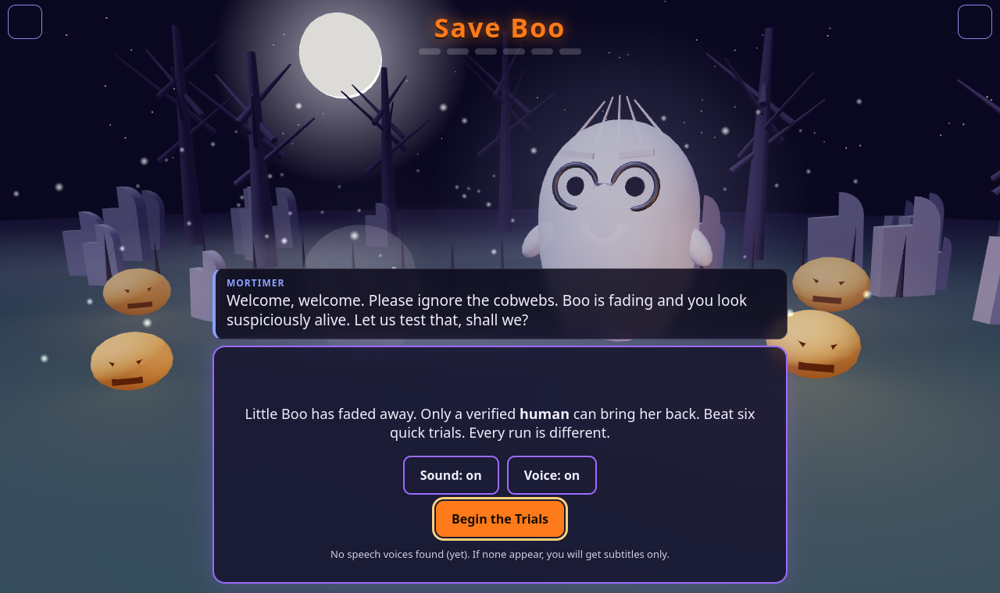
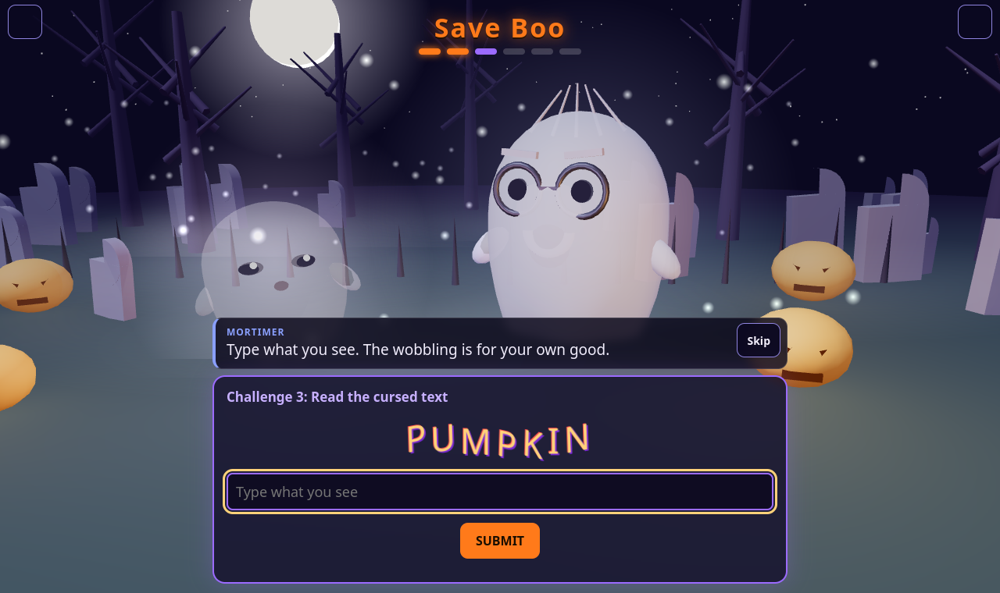
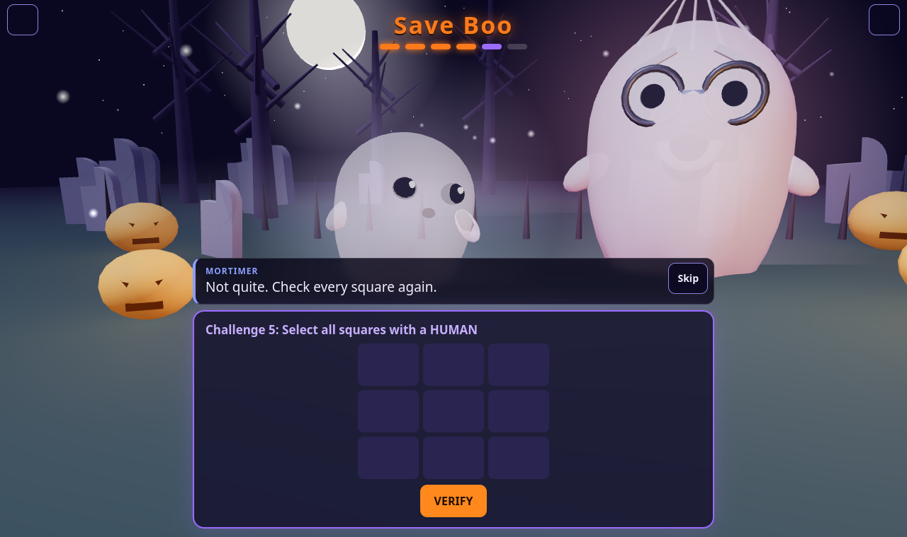
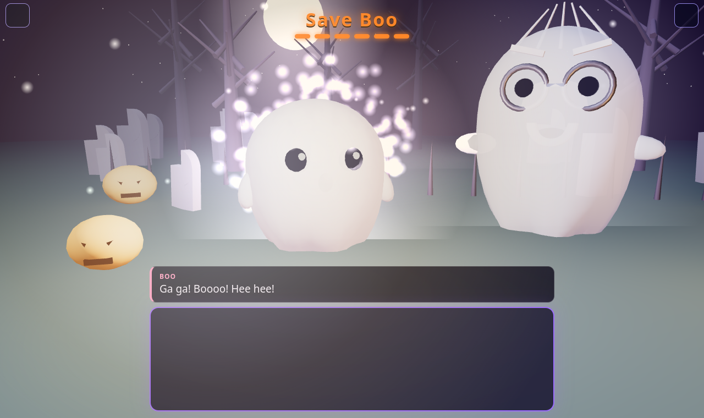
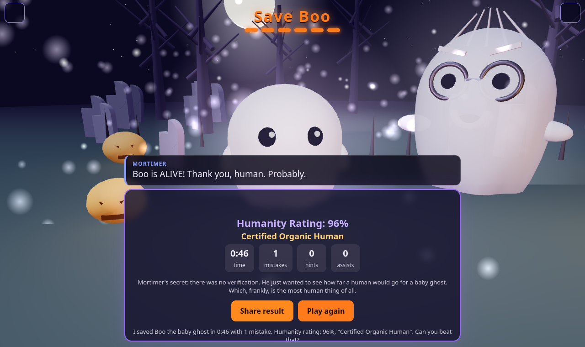
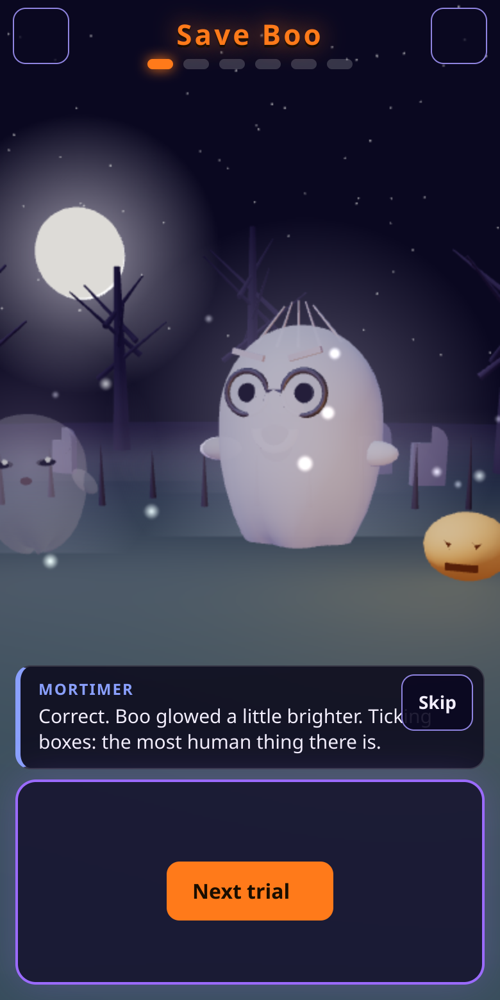

# Save Boo

**Baby ghost Boo has stopped moving. Prove you are human to bring him back.** A 3D Halloween mini game with voice overs, six absurd "prove you are human" trials, and a Grandghost Mortimer who can improvise with a live AI model so every retry plays differently.

**[Play the live demo](https://hackerdy.github.io/save-boo/)**

| Intro | A trial | Mortimer is unimpressed |
| --- | --- | --- |
|  |  |  |

| Finale | Results card | Mobile |
| --- | --- | --- |
|  |  |  |

## Features

- 3D night graveyard (Three.js): procedural ghosts, fireflies, fog, moonlight, a camera that reacts to mistakes and a finale light burst
- Voice overs with subtitles: Mortimer speaks low and slow, Boo high and fast (Web Speech API, synthesized WebAudio effects, no audio files)
- Six trials with a different order and variants on every run (runaway checkbox, "select the humans" style grids, cursed text, breathing, heartbeat, a confession)
- Live **AI Mortimer** with scripted fallback (below)
- Humanity Rating results card with a share button
- Settings: mute, AI toggle, reduced motion, low power mode, bring your own endpoint
- Gentle difficulty: after repeated mistakes Mortimer softens and offers a mercy button
- Works offline and from `file://`; without WebGL it falls back to an emoji stage

## Accessibility

- Fully playable by keyboard, covered by an automated keyboard-only playthrough
- Honors `prefers-reduced-motion` (no screen shake, no runaway checkbox) plus a manual toggle
- Subtitles always shown with speaker names, even when muted
- Focus is managed between trials and touch targets are sized for mobile

## Controls

| Action | Pointer | Keyboard |
| --- | --- | --- |
| Begin, next trial | Click | Enter |
| Skip a line | Skip button | Space or Escape |
| Breathing trial | Hold the button | Hold Space |
| Mute, settings | Header buttons | Tab then Enter |

## AI Mortimer

Mortimer can improvise fresh lines: greetings, trial intros, taunts, praise, idle hints, a reaction to your typed confession, the finale twist and the final verdict.

- **How it works:** `src/game/ai.ts` calls an OpenAI-compatible chat completions API straight from the browser. The default is the keyless free [Pollinations](https://text.pollinations.ai/openai) endpoint, so there is no backend and no secret in this repo. Lines are prefetched while the current one plays, so there is no added latency.
- **Always falls back:** every call has a 4 second timeout, output is sanitized (no markdown, emoji or quotes, under 160 characters, unsafe or off-persona text rejected, repeats rejected). On any error, timeout, 429 or bad response the scripted pools in `src/game/lines.ts` are used silently. After 3 failures in a row the AI is skipped for the rest of the run. At most one request is in flight and a run makes at most 40 calls.
- **Privacy:** only game context is sent (trial name, mistake count, elapsed time, recent AI lines). Your typed confession is sent only for Mortimer's reaction to it, the trial says so under the text box, and it has its own opt-out. With the **AI Mortimer** toggle off (gear icon) the game makes zero AI requests.
- **Bring your own model:** Settings > "Use my own AI endpoint" accepts any OpenAI-compatible base URL (https, or http on localhost), model and API key, stored only in your browser's localStorage and sent only to the endpoint you entered.
- **CORS:** Pollinations answers with `access-control-allow-origin: *`, so it works from GitHub Pages and `file://`. If it ever stops, the game stays on scripted lines.

## Built with Kiro

Built with [Kiro](https://kiro.dev) as an agent-driven workflow: a plan split into features (player experience, live AI, process and docs), each implemented against a task file with acceptance criteria, verified by unit tests and a headless Playwright playthrough, and committed separately. The playthroughs double as the test report in [docs/TEST_REPORT.md](docs/TEST_REPORT.md).

## Run, develop, test

```
npm ci
npm run dev          # dev server with hot reload
npm run build        # typecheck + production build into dist/index.html
npm run preview
npm test             # vitest unit tests (pure game logic and the AI client)
```

End to end playthroughs (Playwright is not a project dependency):

```
npm install --no-save playwright@1.49.1 && npx playwright install chromium
node scripts/playthrough.mjs desktop                 # also: mobile | nowebgl | keyboard
PLAY_AI=mock node scripts/playthrough.mjs desktop    # also: block (default) | off
```

Screenshots land in the gitignored `.playthrough-shots/`.

## CI and deploy

- `.github/workflows/ci.yml` runs on pull requests and pushes to `main`: typecheck, unit tests, build, a **bundle size budget** (fails above 1.5 MB, size shown in the job summary), then six playthroughs (desktop, mobile, nowebgl, keyboard, AI mock, AI off). npm and Playwright browsers are cached, superseded runs are cancelled, and screenshots are uploaded as an artifact when a run fails.
- `.github/workflows/deploy.yml` publishes `dist/` to GitHub Pages on every push to `main`.
- **One manual step:** in the repo go to **Settings > Pages > Source** and choose **GitHub Actions**, otherwise the deploy job cannot publish.

## Bundle size

`dist/index.html` is 629 KB (178 KB gzipped) with React, Three.js, styles and game code all inlined. It stays a single file on purpose so it opens from disk. Three.js is imported as a namespace in one module and Rollup already drops unused code paths; no further splitting was done because it would break the single file build.

## More

See [docs/ARCHITECTURE.md](docs/ARCHITECTURE.md) for the state machine, the `ChallengeCtx` API and how to add a challenge. Voices come from the browser or OS, so the exact sound varies; on Linux or Android both ghosts may share a voice and differ only by pitch.
